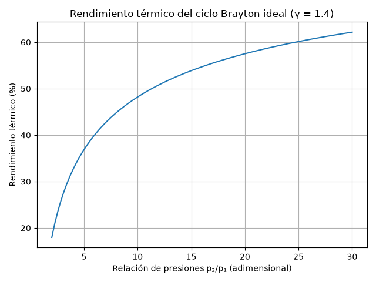
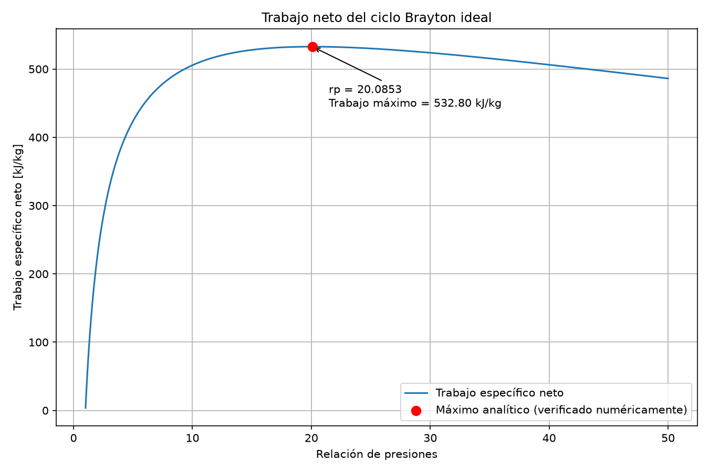

# Brayton Cycle Simulator

## Overview

An educational Python simulator for studying gas turbine thermodynamics through ideal and simplified non-ideal Brayton cycles. It calculates cycle states, energy balances and pressure-ratio trends, and creates a self-contained HTML report for each execution.

## Objectives

- Apply thermodynamics and propulsion concepts to an engineering problem.
- Learn scientific programming with Python.
- Perform parametric analyses and interpret their results.
- Generate thermodynamic diagrams with consistent units.
- Learn a development workflow using VS Code, Codex, Git and GitHub.

## Features

- Ideal-cycle temperatures, thermal efficiency and specific energy balances.
- An ordered efficiency table for pressure ratios of 5, 10, 15, 20 and 25.
- Ideal-cycle relative entropies, pressures and specific volumes.
- Ideal T-s and P-v diagrams with numbered states, curved thermodynamic processes and direction arrows.
- Analytical ideal/non-ideal net-work optimization, checked by independent logarithmic sampling and golden-section refinement in each current motor domain.
- A separate non-ideal model with compressor and turbine isentropic efficiencies and combustor pressure loss.
- HTML tables comparing ideal and non-ideal temperatures, pressures, energy balances, efficiencies and back work ratios.
- Efficiency and net-work comparisons over dynamic pressure-ratio domains, with work/efficiency design markers and detail panels when needed.
- Physical input validation and runtime consistency checks, including recovery of the ideal cycle when both component efficiencies are 1 and pressure loss is zero.
- Ideal/non-ideal motor domains, simultaneous exclusion reasons, numerical work boundaries and adapted pressure-ratio sweeps.
- Seven fresh Matplotlib PNG plots embedded as Base64 in a single offline HTML report, using the Agg backend.
- Four most recent completed reports retained in `outputs/`; historical PNGs and unrelated files are preserved.
- Brief terminal summary with the report path and number of embedded plots.
- Optional offline local Flask form for all nine inputs, with server-side validation and the same reports/history as the terminal mode.

## Thermodynamic model

Both models use an ideal gas with constant specific heat $c_p$ and heat-capacity ratio $\gamma=c_p/c_v$. Compressor and turbine balances assume steady, adiabatic flow and neglect changes in kinetic and potential energy.

States are: **1**, compressor inlet; **2**, compressor outlet; **3**, turbine inlet; **4**, turbine outlet. Define the compressor pressure ratio as $r_p=p_2/p_1$ and $a=(\gamma-1)/\gamma$.

### Ideal cycle

Compression and expansion are isentropic. Heat addition and rejection occur at constant pressure, with $p_2=p_3=r_pp_1$ and $p_4=p_1$:

$$
T_2=T_1r_p^a,\qquad T_4=\frac{T_3}{r_p^a},\qquad
\eta_{th,ideal}=1-\frac{1}{r_p^a}.
$$

With $c_p$ in J/(kg·K), the following specific energies are in kJ/kg. Compressor work is reported as a positive consumption:

$$
\begin{aligned}
w_c&=\frac{c_p(T_2-T_1)}{1000}, &
w_t&=\frac{c_p(T_3-T_4)}{1000},\\
w_{net}&=w_t-w_c, &
q_{in}&=\frac{c_p(T_3-T_2)}{1000},\\
\eta_{th}&=\frac{w_{net}}{q_{in}}, &
\mathrm{BWR}&=\frac{w_c}{w_t}.
\end{aligned}
$$

The program checks that the energy-balance efficiency matches the ideal formula. At fixed inlet and maximum temperatures, maximum ideal net work occurs at:

$$
r_{p,opt}=\left(\frac{T_3}{T_1}\right)^{\gamma/[2(\gamma-1)]}.
$$

Relative entropy uses $s_1=0$, $s_2=s_1$, and $s_4=s_3$. On an isobar:

$$
\Delta s=\frac{c_p}{1000}\ln\left(\frac{T_{final}}{T_{initial}}\right).
$$

Entropy is expressed in kJ/(kg·K). The program checks that $\Delta s_{2\to3}=\Delta s_{1\to4}$. The T-s isobars follow this logarithmic relation.

The P-v calculation uses:

$$
R=c_p\left(1-\frac{1}{\gamma}\right),\qquad
v=\frac{RT}{P},\qquad Pv^\gamma=\text{constant on an isentrope}.
$$

Here $R$ is in J/(kg·K), $P$ must be in Pa for the gas equation, and $v$ is in m³/kg. The code converts its kPa pressures to Pa when calculating volumes and checking $Pv=RT$.

### Non-ideal cycle

Let $\delta$ be the relative combustor pressure loss. The model uses:

$$
\begin{aligned}
T_{2s}&=T_1r_p^a, &
T_2&=T_1+\frac{T_{2s}-T_1}{\eta_c},\\
p_2&=p_1r_p, &
p_3&=p_2(1-\delta),\qquad p_4=p_1,\\
T_{4s}&=T_3\left(\frac{p_4}{p_3}\right)^a, &
T_4&=T_3-\eta_t(T_3-T_{4s}).
\end{aligned}
$$

The suffix **s** denotes an isentropic reference at the corresponding inlet and outlet pressures; $T_2$ and $T_4$ are the non-ideal component outlet temperatures. Because of combustor pressure loss, the non-ideal $T_{4s}$ differs from the ideal-cycle $T_4$.

The same energy-balance equations above apply to the non-ideal temperatures. Heat addition remains represented by $c_p(T_3-T_2)$; fuel chemistry and fuel mass addition are not modeled. The code requires $0<\eta_c,\eta_t\leq1$, $0\leq\delta<1$, positive finite states, $p_3>p_4$, positive heat input and positive net work.

## Physically viable domain (Phase 1)

The input family requires finite values with T3 > T1 > 0, gamma > 1, positive cp/p1, efficiencies in (0,1] and loss in [0,1). Mathematical input validity is distinct from motor viability and from numerical representability.

The ideal motor domain is open:

$$1 < r_p < (T_3/T_1)^{\gamma/(\gamma-1)}.$$

For the non-ideal model, require compression, expansion p3 > p4, heat input T3 > T2 and positive net work wt > wc. Expansion requires rp > 1/(1−delta); positive heat requires rp < [1+eta_c*(T3/T1−1)]^(1/a). With x=rp^a, h=(T3/T1)*eta_c*eta_t and k=(1−delta)^(−a), positive work is equivalent to:

```text
Q(x) = (x−1)*(x−h) + h*(k−1) < 0
```

Convexity proves that this region, intersected with the other constraints, is an open interval or empty for the current model. Work boundaries are bracketed using this quadratic and located by bisection (relative tolerance 1e-12 in x). This is root finding; Phase 2 reuses these boundaries for the independently implemented work optimization.

Default bounds: ideal **1 < rp < 403.4175203200**; non-ideal **1.0696541023 < rp < 155.4543260392**. The non-ideal expansion bound is 1.0526315789 and the heat upper bound is 254.8459320044; net work supplies the tighter bounds. The ideal work optimum, rp≈20.085256, is a separate interior point.

The self-contained report adds **Dominio físicamente viable**, with conditions, boundaries, reference status and counts of all exclusion reasons (which may overlap). The plot grid combines linear/logarithmic samples and boundary neighbours, with fewer than 1300 points; the default case now uses 1282 samples over [1,423.5883963360], including local samples around the reference and both work maxima and the efficiency maximum. This display window differs from each physical domain and numerical search window. NaN breaks curves at excluded points; thermal efficiency is not reported there.

To inspect an excluded point without exceptions for expected physical failure:

```python
from viabilidad import evaluar_punto, calcular_dominios
punto = evaluar_punto(288.15, 1600, 1.4, 1005, 200, 100, .85, .9, .05)
print(punto["motivos"])       # ('trabajo_neto',): heat input is still positive
print(punto["rendimiento"])   # None
limites = calcular_dominios(288.15, 1600, 1.4, 1005, 100, .85, .9, .05)
```

Invalid arguments raise `ValueError`; an unrepresentable calculation raises `ErrorNumerico`, not a physical non-motor classification. Near zero, point classification uses a relative band of 1e-10 scaled separately for dimensionless ratios, pressure and energy. These tolerances address rounding, not experimental uncertainty.

## Non-ideal net-work optimization (Phase 2)

With $a=(\gamma-1)/\gamma$, the stationary pressure ratio is

$$r_{p,*}=\left[\frac{\eta_c\eta_t T_3}{T_1(1-\delta)^a}\right]^{1/(2a)}.$$

It is accepted only inside the open motor domain computed by Phase 1 for the current parameters. When the domain is nonempty the candidate is its interior maximum; empty domains produce no fictitious optimum. Numerical optimization does not use the analytical candidate to select its window. Physical, search and plotting intervals are distinct. The nine Flask fields stay unchanged; cp scales work, p1 scales pressure, and the reference rp does not constrain the search.

The HTML includes analytical/numerical agreement, work and efficiency at the work maximum, optimal state temperatures/pressures, ideal versus non-ideal differences and explicit numerical tolerances. See the [technical milestone](docs/milestones/04_optimizacion_noideal.md) and the independent Spanish [Phase 2 learning guide](docs/milestones/04_optimizacion_noideal_APRENDIZAJE.md). Efficiency optimization is described in Phase 3 below.

## Thermal efficiency and design trade-off (Phase 3)

The report now includes **Optimización del rendimiento térmico**. The ideal efficiency $1-r_p^{-a}$ is strictly increasing on its open motor domain. It has no interior maximum: its unattained supremum is $1-T_1/T_3$, approached at an excluded boundary where heat and work vanish. No ideal efficiency optimum or fictitious point B is returned.

With any strictly positive loss and a nonempty non-ideal motor domain, the efficiency has a unique interior maximum. A stable analytical stationary candidate is checked against an independent logarithmic search with golden-section refinement. Empty domains return no motor optimum; unresolved cases raise an explicit numerical error. Neither search nor plot uses the form's reference pressure ratio as a fixed bound.

For the default parameters:

| Design point | rp | Net work [kJ/kg] | Efficiency [%] | Heat input [kJ/kg] |
|---|---:|---:|---:|---:|
| A: maximum net work | 12.895052 | 373.210827 | 39.212614 | 951.762164 |
| B: maximum efficiency | 35.452324 | 313.738915 | 43.893107 | 714.779462 |

B gains **4.680493 percentage points**, reduces work by **15.935205%** relative to A and changes heat input by **−236.982702 kJ/kg**. The numerical efficiency optimum is rp≈35.4523219222, agreeing with the analytical rp≈35.4523235708 within the declared tolerance. The default ideal supremum is **81.990625%**, unattained.

The six earlier plots are preserved. Comparative rp plots show a blue circle for ideal maximum work, an orange diamond for A and a green star for B. A seventh plot shows non-ideal net work horizontally and efficiency vertically, with rp as the curve parameter. Excluded samples remain NaN gaps; the entire curve is not automatically a Pareto frontier. The HTML includes optimal temperatures/pressures, physical/search intervals, numerical agreement, units and limitations.

The nine local Flask fields, Git metadata, self-contained download and four-report retention are unchanged. Each POST recomputes domains and both optimization criteria from its current values. See the [Phase 3 technical milestone](docs/milestones/05_optimizacion_rendimiento.md) and the Spanish [independent learning guide](docs/milestones/05_optimizacion_rendimiento_APRENDIZAJE.md).

## Example parameters

Current values defined in `main.py`:

| Parameter | Value |
|---|---:|
| Compressor inlet temperature, $T_1$ | 288.15 K |
| Turbine inlet temperature, $T_3$ | 1600 K |
| Compressor pressure ratio, $r_p$ | 10 |
| Heat-capacity ratio, $\gamma$ | 1.4 |
| Specific heat, $c_p$ | 1005 J/(kg·K) |
| Compressor inlet pressure, $p_1$ | 100 kPa |
| Compressor isentropic efficiency, $\eta_c$ | 0.85 |
| Turbine isentropic efficiency, $\eta_t$ | 0.90 |
| Relative combustor pressure loss, $\delta$ | 0.05 (5%) |

Derived pressures are 1000 kPa at states 2 and 3 of the ideal cycle. In the non-ideal cycle, $p_2=1000$ kPa and $p_3=950$ kPa. Both models use $p_4=100$ kPa.

## Example results

Results verified by executing the current code with the parameters above; values are rounded for presentation:

| Quantity | Ideal | Non-ideal |
|---|---:|---:|
| $T_{2s}$ [K] | 556.33 | 556.33 |
| $T_2$ [K] | 556.33 | 603.66 |
| $T_{4s}$ [K] | 828.72 | 840.95 |
| $T_4$ [K] | 828.72 | 916.86 |
| Compressor work [kJ/kg] | 269.52 | 317.08 |
| Turbine work [kJ/kg] | 775.14 | 686.56 |
| Net work [kJ/kg] | 505.62 | 369.48 |
| Heat input [kJ/kg] | 1048.89 | 1001.33 |
| Thermal efficiency [%] | 48.21 | 36.90 |
| Back work ratio [-] | 0.3477 | 0.4618 |

For the ideal cycle, $s_1=s_2=0$ and $s_3=s_4=1.061678$ kJ/(kg·K). The derived gas constant is 287.142857 J/(kg·K).

The ideal net-work optimum is **20.0852562921** analytically and **20.0852560217** numerically. Its maximum work is **532.802230 kJ/kg**. The non-ideal optimum is **12.8950516696** analytically and **12.8950517350** numerically, with **373.210827 kJ/kg** and thermal efficiency **39.212614% at maximum work**. This does not maximize efficiency. Both searches use the current physically viable domains, with an independent logarithmic grid and golden-section refinement.

## Generated plots

The images below are historical reference previews. New executions embed all seven newly generated plots directly in their HTML report and do not overwrite these PNG files.



Historical preview of ideal thermal efficiency from 2 to 30. Current reports use the adapted motor-domain grid and exclude non-motor efficiencies.


Ideal T-s diagram with vertical isentropic stages and curved constant-pressure heat addition and rejection.


Ideal P-v diagram with curved isentropic compression and expansion, horizontal isobars and cycle-direction arrows.



Historical preview over 1.01 to 50. Current plots cover the complete adapted ideal motor domain and its boundary, without a fixed pressure-ratio cap. Numerical optimization uses a separate interior window derived from each current physical domain, with 257 logarithmic samples and golden-section refinement.


Historical preview over 2 to 30. Current reports compare each model only inside its motor domain, with physical boundary markers and separate masks.


Historical preview over the same range. Current comparative curves mark ideal maximum work, A (non-ideal maximum work) and B (non-ideal maximum efficiency, when attained), use NaN gaps at excluded samples, and add a non-ideal detail panel when the scales differ strongly. All seven current PNGs are 1350 × 900 and embedded in each HTML report; historical previews are preserved.

## Project structure

```text
Brayton_Simulator/
├── main.py
├── optimizacion.py
├── optimizacion_rendimiento.py
├── sensibilidad.py
├── viabilidad.py
├── reporting.py
├── segunda_ley.py
├── mapa_diseno.py
├── dashboard.py
├── web_app.py
├── Abrir_Brayton_Simulator.cmd
├── templates/index.html
├── static/style.css
├── static/dashboard.js
├── static/fonts/               # bundled IBM Plex + SIL OFL
├── static/images/              # original engine schematic + CC0
├── tests/test_optimizacion.py
├── tests/test_optimizacion_rendimiento.py
├── tests/test_integracion_rendimiento.py
├── tests/test_sensibilidad.py
├── tests/test_segunda_ley.py
├── tests/test_mapa_diseno.py
├── tests/test_dashboard.py
├── tests/test_viabilidad.py
├── tests/test_reporting.py
├── tests/test_web_app.py
├── AGENTS.md
├── CODE_WALKTHROUGH.md
├── docs/milestones/
├── outputs/                    # generated HTML reports, ignored by Git
├── requirements.txt
├── README.md
├── .gitignore
├── rendimiento_brayton.png
├── diagrama_ts_brayton.png
├── diagrama_pv_brayton.png
├── trabajo_neto_vs_rp.png
├── comparacion_ideal_noideal.png
└── trabajo_neto_ideal_noideal.png
```

## Installation

Install Python 3 and Git. In Windows PowerShell, replace `YOUR_REPOSITORY_URL` with this repository's clone URL:

```powershell
git clone YOUR_REPOSITORY_URL Brayton_Simulator
cd Brayton_Simulator
python -m venv .venv
.\.venv\Scripts\Activate.ps1
pip install -r requirements.txt
```

If PowerShell does not allow activation, install dependencies directly through the virtual environment:

```powershell
.\.venv\Scripts\python.exe -m pip install -r requirements.txt
```

The local `.venv` directory is excluded by `.gitignore` and is not part of the repository.

## Usage

From the repository directory, with the virtual environment active:

```powershell
python main.py
```

Alternatively, on Windows:

```powershell
.\.venv\Scripts\python.exe main.py
```

Each report header records the full Git HEAD hash and warns about staged, unstaged or untracked changes. If Git cannot be queried, it explicitly shows an unknown version state. Ignored reports do not count as changes. All seven plots use 1350 × 900 pixels.

The program prints only completion status, the absolute report path and the number of embedded plots. Full results, units, checks and all seven fresh plots are in `outputs/brayton_DATE_TIME_MICROSECONDS_UUID.html`. The directory is created automatically beside `main.py`, independently of the working directory. Open the report locally in Chrome or Edge; no Internet connection, image files, server or framework is required.

In VS Code, expand `outputs/`, locate the report named in the terminal, then reveal it in File Explorer and open it in a browser. Opening it in the text editor displays its HTML source; an HTML preview extension is optional.

Only after a complete report has been written and published does the program retain the four newest completed reports it recognizes by exact filename and internal markers. Calculation or publication errors preserve earlier reports and propagate a traceback. A later cleanup error emits a warning and may leave more than four valid reports. Unrelated files and historical PNGs are untouched. Names include microseconds and UUIDs to avoid collisions; concurrent retention is not protected by a process lock. Publication targets the project's Windows environment.

To explore other cases, use the local form below or call `main(parametros={"T3": 1700})` from Python. Inputs not supplied in that dictionary retain `PARAMETROS_PREDETERMINADOS`; internal combustor loss is a fraction. `main(output_folder)` remains compatible. There is no command-line argument parser. Importing `main` or `web_app` does not run simulations or start a server. Terminal messages, form/report content and plot labels are in Spanish. The README uses English; the educational manual and phase guides are in Spanish.

### Local web interface from VS Code

**Windows shortcut:** double-click `Abrir_Brayton_Simulator.cmd` in the project folder. It starts the existing local Flask app using `.venv` and opens your default browser once the form responds. Keep the server console open; Ctrl+C stops it. If the form is already running, it opens that instance without launching another server. Install the existing requirements first; the launcher does not install anything. Missing dependencies or startup failures remain visible in the console. A different application occupying port 5001 must be stopped before retrying. No simulation runs until you submit the form.

Open the project folder and a PowerShell terminal in `C:\Proyectos\Brayton_Simulator-gas_perfecto_GitHub`. Install the requirements in the existing virtual environment, then start the server:

```powershell
.\.venv\Scripts\python.exe -m pip install -r requirements.txt
.\.venv\Scripts\python.exe web_app.py
```

With the virtual environment activated, the second command is simply `python web_app.py`. Open [Brayton Simulator locally](http://127.0.0.1:5001) in Chrome or Edge. Edit the nine fields and click **Ejecutar simulación**. Temperatures use K, pressure uses kPa, cp uses J/(kg·K), efficiencies are fractions and combustor pressure loss is entered as a percentage (5 means 5 %, converted internally to 0.05).

The completed report opens after a redirect. **Volver al formulario** lets you run another case without restarting the server; **Restablecer valores** loads the defaults. **Descargar informe HTML** downloads the original self-contained file, without server navigation links. Both modes share `outputs/` and its four-report retention. An older report URL returns 404 after that report is removed by retention.

The server validates missing/non-numeric/non-finite values and all individual ranges. A non-motor reference case shows all failed physical conditions and its open pressure-ratio interval when available, preserving submitted values. Numerical representation limits use a distinct message. Sweeps classify excluded points without aborting valid regions. These errors do not publish a report or clean the history. Unexpected failures are logged with a traceback in the terminal and return a generic HTTP 500, without exposing internal details in the browser.

Stop the server with **Ctrl+C**. It binds only to `127.0.0.1:5001`, with debug, reloader and threading disabled. Requests are handled sequentially to keep Matplotlib isolated per simulation. Do not change the bind address for this local workflow. If port 5001 is already occupied, stop the other local instance before restarting. Flask is the only new direct dependency; the initial installation requires downloaded or locally cached packages, but use after installation needs no Internet. This is a local development tool, with no public deployment or accounts.

To run both independent simulators simultaneously, use two PowerShell terminals with the existing environments:

```powershell
# Terminal 1: cp(T) — http://127.0.0.1:5000
Set-Location 'C:\Proyectos\Brayton_Simulator'
.\.venv\Scripts\python.exe -B web_app.py
```

```powershell
# Terminal 2: perfect gas — http://127.0.0.1:5001
Set-Location 'C:\Proyectos\Brayton_Simulator-gas_perfecto_GitHub'
.\.venv\Scripts\python.exe -B web_app.py
```

The fixed ports apply when running `web_app.py` directly. If 5001 is occupied, the perfect-gas process exits with an error in the terminal; it never selects another port automatically. Relative navigation and report links stay on the application's own server. Existing standalone reports do not require URL changes.

Run the verification suite from the repository root with the virtual environment active:

```powershell
python -B -m unittest discover -s tests -v
```

Or explicitly on Windows:

```powershell
.\.venv\Scripts\python.exe -B -m unittest discover -s tests -v
```

The previous Phase 3 closure passed **83 tests** (all retained; Phase 4 adds 25 tests): all 55 Phase 2 methods, 20 efficiency unit tests and eight integration tests. Coverage includes physical domain limits, empty domains, simultaneous causes, root neighbours, NaN in plotted lines and five complete runs in temporary directories, numerical reference checks, embedded PNG checks, retention, failure handling and protection of unrelated files. Flask `test_client` additionally checks GET/POST, modified inputs, model rejections, internal errors, download/view restrictions and mixed terminal/web retention without opening sockets. See `CODE_WALKTHROUGH.md` for the educational explanation and `docs/milestones/01_html_reports.md` for the reporting milestone; Phase 1 is documented in `docs/milestones/03_dominio_viable.md`.

### OFAT sensitivity analysis (Phase 4)

Start the same local Flask server. Keep the nine physical inputs and open **Análisis de sensibilidad**. Select T1 or T3 [K], eta_c or eta_t [fraction], or delta [fraction]; changing the selector fills an educational suggested range. Edit the minimum, maximum and integer sample count (3–201, default 41), then click **Ejecutar análisis de sensibilidad**. These suggested ranges are not universal physical limits. The main combustor-loss field still uses percent; the separate delta study uses fractions (0.05 = 5%). Submitted study settings and physical inputs are retained on errors.

R keeps the form's rp fixed; A re-optimizes specific net work; B re-optimizes thermal efficiency. Each sample recalculates ideal/non-ideal domains and checks the Phase 2/3 analytical candidates against physical viability. Independent numerical searches verify selected samples (endpoints, centre and nearest to the reference), explicitly identified per result. Empty domains, invalid temperature combinations and numerical limits remain visible in the tables; an unattained supremum never becomes point B.

The separate self-contained sensitivity report contains three 1350×900 plots (W, efficiency, rp), signed diagnostics for excluded R points, domains, methods, reasons, Git metadata, trends and local derivatives/elasticities at the form reference. NaN gaps prevent connecting unavailable samples in every operational curve, including R pressure ratio. A separate grey dash-dot line labelled as the reference setpoint spans the rp plot without implying viability; R operating samples use circle markers and remain masked. Both report types share the same safe publication and four-report history. The normal button and `python main.py` still produce seven plots without running OFAT.

Example without writing files:

```python
from main import PARAMETROS_PREDETERMINADOS
from sensibilidad import analizar_sensibilidad
study = analizar_sensibilidad(PARAMETROS_PREDETERMINADOS, "T3", 800, 2000, muestras=41)
print(study["sensibilidades"]["A"]["rp"]["normalizada"])  # approximately 1.75
```

OFAT does not measure parameter interactions or a universal importance ranking. Relative efficiency changes differ from percentage-point changes. Local coefficients use h/h2 checks, reject unavailable/ill-conditioned results, and do not replace experimental validation. See the [Phase 4 learning guide](docs/milestones/06_sensibilidad_parametrica_APRENDIZAJE.md) and [technical milestone](docs/milestones/06_sensibilidad_parametrica.md).

### Technical dashboard redesign

The local app now has eight sections: **Simulación, Resultados, Optimización, Sensibilidad, Mapa de diseño, Segunda ley, Informes, Ayuda**. Normal runs open Resultados with six non-ideal KPI cards and physical-domain status. Seven original PNGs are grouped into Rendimiento, Trabajo, Diagramas termodinámicos, Compromiso de diseño and Todas; the last view reuses the same images in a grid. OFAT uses three separate tabs, scenario availability counts, a local-elasticity summary and collapsible complete tables. Native dialogs enlarge charts and close with Escape. Arrow keys/Home/End operate chart tabs; section fragments support direct navigation and browser history. Navigation never reruns calculations.

The nine physical inputs keep their names, defaults, units and validation. Reports viewed through Flask recover their saved parameters for another run. Informes lists retained complete reports with view/download controls and available metadata; older reports keep their original layout. Downloads are the original offline files, without local-server navigation. The same four-report retention applies. README and walkthrough have narrowly scoped local text routes from Ayuda.

Offline reports share the new layout, inline CSS/JS, an original CC0 SVG engine schematic, Base64 PNGs and embedded local IBM Plex fonts. Sans Regular/SemiBold and Mono Regular come unmodified from the official IBM/plex repository, under SIL OFL 1.1; provenance and pinned upstream commit are in `static/fonts/SOURCE.md`, licenses in `static/fonts/OFL.txt` and `static/images/LICENSE.txt`. No CDN or Internet is needed at runtime. Without JavaScript, all sections/plots remain accessible and native disclosure tables work; execution controls in offline files are disabled because new calculations require the local server.

Responsive layout uses a 232 px sidebar, three/two/one KPI columns and a mobile menu. Wide tables scroll within their own containers. The redesign does not change any thermodynamic source, optimizer, domain, original plot bytes or dependencies. See [redesign learning guide](docs/milestones/07_rediseno_dashboard_APRENDIZAJE.md) and [technical milestone](docs/milestones/07_rediseno_dashboard.md). The dashboard introduced 15 tests on top of the 108 Phase 1–4 tests (123 before Phase 5); Phase 5 adds 21 map tests and 16 educational-presentation tests (160 total; latest full verification: 160/160 OK in 239.457 s). Static tests are distinguished from real-browser interaction checks.

### Design map rp–T3 (Phase 5)

Open **Mapa de diseño** in the local Flask dashboard. It varies compressor pressure ratio and turbine inlet temperature while keeping the other seven physical inputs fixed. Defaults: rp 1–100 (logarithmic or linear), T3 600–2000 K, 100×80 samples; T3 minimum must exceed T1. Limits: 3–401 samples per axis, 20000 cells and five exact-temperature cuts (comma-separated; empty selects endpoints/midpoint).

Three maps show motor net work [kJ/kg], thermal efficiency [%] and viability, with physical A/B trajectories independent of grid resolution. Grey cells carry no motor performance; signed energies, exclusion reasons and numerical-limit flags remain in study data. Physical optima outside the plotted window remain in the results table. Reversible efficiency is an unattained supremum, with no point B. Cell edges are not exact physical boundaries. Cut selection and chart tabs only switch saved images.

The standalone report embeds resources, seven fixed parameters/units, Git metadata, maps, cuts and collapsed A/B tables. It shares the four-report retention policy with normal/OFAT runs. No equations, optimizers or dependencies change. Module API: `mapa_diseno.analizar_mapa(parameters, n_rp=100, n_T3=80)`; publication: `mapa_diseno.ejecutar_mapa(output_directory, parameters, **configuration)`. See [learning guide](docs/milestones/08_mapa_diseno_rp_t3_APRENDIZAJE.md) and walkthrough §4.42. New calculations require the local Python server; saved reports work without Internet.

### Second law and component exergy destruction (Phase 6)

Normal reports now include **Segunda ley**: relative entropy at four ideal/non-ideal states (s1=0), adiabatic compressor/turbine entropy generation [kJ/(kg·K)] and component exergy destruction [kJ/kg] at independent ambient reference **T0=288.15 K**. The original seven PNGs remain unchanged; two embedded vector SVGs compare T-s states and component destruction. Dashed connections are visual guides, not internal irreversible process paths.

T0 changes only eD=T0·s_gen. The component sum is **not** the destruction of the whole installation or the direct ideal/non-ideal work difference. Chamber s3−s2 is a fluid entropy change, not its entropy generation: heat-transfer boundary temperatures or combustion modeling are still missing. No global exergetic efficiency is invented.

The section can run a diagnostic for calculable non-motor states or update T0 from a retained report with identical physical inputs, without reevaluating states/optimizers/maps. Normal calculations accept `main(directory, parameters, T0=300)`; direct diagnostic API is `segunda_ley.ejecutar_segunda_ley(directory, parameters, T0=300)`. Reports remain standalone, with the shared four-report history; OFAT/maps do not run second-law analyses per sample. See walkthrough §4.44, [technical milestone](docs/milestones/09_segunda_ley_exergia.md) and [learning guide](docs/milestones/09_segunda_ley_exergia_APRENDIZAJE.md).

## Educational documentation

- [CODE_WALKTHROUGH.md](CODE_WALKTHROUGH.md): complete manual of the current code, equations, functions and execution flow.
- [Phase 1 learning guide](docs/milestones/03_dominio_viable_APRENDIZAJE.md): independent explanation of what changed relative to the base commit, how it was implemented, engineering/Python concepts and practical experiments.
- [Phase 1 technical milestone](docs/milestones/03_dominio_viable.md): concise technical report of the stage; previous milestone files remain available.
- [Phase 3 learning guide](docs/milestones/05_optimizacion_rendimiento_APRENDIZAJE.md): derivation, implementation, Python, numerical methods, exercises and verification in sections A–J.
- [Phase 3 technical milestone](docs/milestones/05_optimizacion_rendimiento.md): efficiency optimization and comparison of design criteria.
- Git: exact committed snapshots of code and their matching documentation.

Each new phase gets its own `NN_nombre_fase_APRENDIZAJE.md`. Smaller iterations within the same phase update that document; the walkthrough stays current without an accumulated iteration history. Earlier phase documents preserve their historical scope. This system starts with Phase 1; no retrospective learning documents are created for the HTML-report or Flask stages.

## Technologies

- **Python** — thermodynamic functions and runtime checks.
- **NumPy** — pressure-ratio grids, arrays and numerical maximum search.
- **Matplotlib** — plots and thermodynamic diagrams using `Agg`.
- **Flask** — local form, HTTP routes and template rendering.
- **Git and GitHub** — version control and repository hosting.
- **VS Code and Codex** — editor and development assistance.

## Limitations

- This is an educational, simplified cycle model, not a detailed gas turbine engine model.
- Gas properties are constant; temperature-dependent heat capacities and combustion-product composition are not represented.
- Non-ideal behavior is limited to fixed isentropic efficiencies and combustor pressure loss. Mechanical losses, fuel consumption, thrust and component maps are not calculated.
- T-s and P-v diagrams currently describe only the ideal reference cycle. Net-work optimization covers both models; efficiency optimization distinguishes the ideal unattained supremum from the attained non-ideal maximum.
- The plotted pressure-ratio window is recalculated from Phase 1 boundaries each run; bounded sample counts control cost without a fixed physical cap. Extremely narrow domains or floating-point limits can still be unresolved. A relative zero band of 1e-10 excludes unresolved boundary points. For a normal report the reference case must be a motor in both models; OFAT reports retain non-motor samples and require only valid reference inputs (including T3>T1); standalone optimization returns no motor optimum for empty domains.
- Runtime checks and standalone tests verify implementation and reporting; they do not constitute validation against experimental engine data.

## Future improvements

Potential future work, not currently implemented:

- Extend tests as the physical model grows and further separate numerical studies from plotting when needed.
- Optionally add configuration files or a command-line argument parser; the current local form already accepts parameters.
- Add non-ideal thermodynamic diagrams, if requested.
- Explore temperature-dependent gas properties and regenerative cycles.

## Author / Context

A personal aerospace engineering learning project.
